# Codex Health

一个从本机 Codex 会话记录中查看 Token 用量与 7 天额度的桌面工具：macOS 提供原生菜单栏应用和桌面小组件，Windows 提供 Dashboard、额度悬浮球与摘要卡片。

界面采用「外围 Liquid Glass + 内部极简 Flat Content」：侧栏和工具栏使用系统材质，数据、图表和列表保持黑白灰扁平布局。支持浅色、深色和跟随系统外观；macOS 26 及以上使用 Liquid Glass，较早版本使用系统材质。

在「设置 → 通用 → 外观 → 应用 Logo」中可选择黑白扁平版或玻璃黑白版。黑白扁平版作为默认，切换 Dock、应用内 Logo 和菜单栏标识无需重启；浅色外观使用白底黑字，深色外观使用黑底白字；Finder 中的安装包图标使用黑白扁平版。

> Token、模型和项目统计在本机读取与计算，不上传会话内容或用量数据。账户额度使用当前 Codex 登录向 ChatGPT 查询；凭据只在内存中使用。

## 下载

| 平台 | 安装包 |
| --- | --- |
| macOS 15+（Intel / Apple Silicon） | [1.0.22 安装包](https://github.com/niujt/CodexMeter/releases/tag/macos-v1.0.22)，打开后将 `Codex Health.app` 拖入 Applications |
| Windows x64 | [0.1.1 安装包](https://github.com/niujt/CodexMeter/releases/download/windows-v0.1.1/Codex-Health-0.1.1-windows-x64-setup.exe) |
| Windows ARM64 | [0.1.1 安装包](https://github.com/niujt/CodexMeter/releases/download/windows-v0.1.1/Codex-Health-0.1.1-windows-arm64-setup.exe) |

[Windows 发布说明与校验文件](https://github.com/niujt/CodexMeter/releases/tag/windows-v0.1.1)。Windows 包未签名，原生拖动、置顶和不同 DPI 效果仍待目标机器实测。

当前发布包使用本机开发签名以确保 WidgetKit 扩展能被 macOS 识别；macOS 首次打开时可能提示无法验证开发者。请前往“系统设置 → 隐私与安全性”，在页面底部找到 Codex Health 的提示后选择“仍要打开”。

截图更新于 2026-10-13，基于当前源码（macOS `35a2825`、Windows 0.1.2）。macOS 截取独立演示应用中的真实 SwiftUI 页面，Windows 截取前端演示界面；全部使用虚构数据，不包含真实项目、会话、账户记录或 Token 用量。截图展示源码版本，下载区仍指向已发布安装包。

## 健康报告

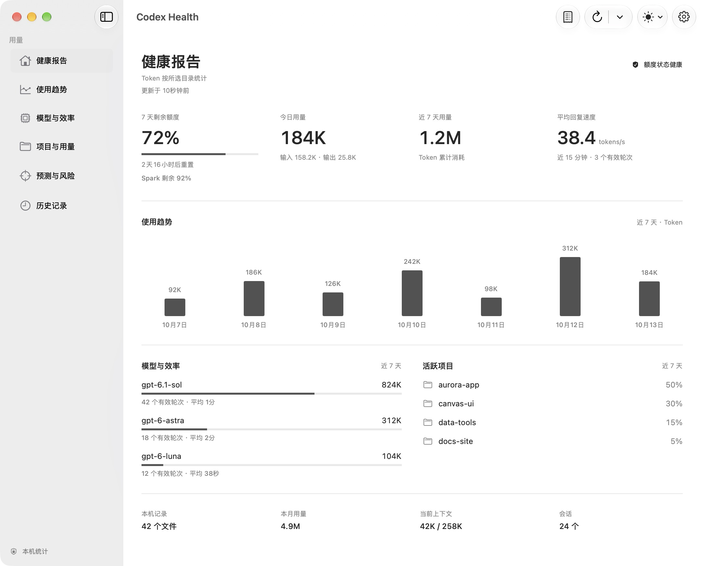

<details>
<summary>查看深色模式</summary>

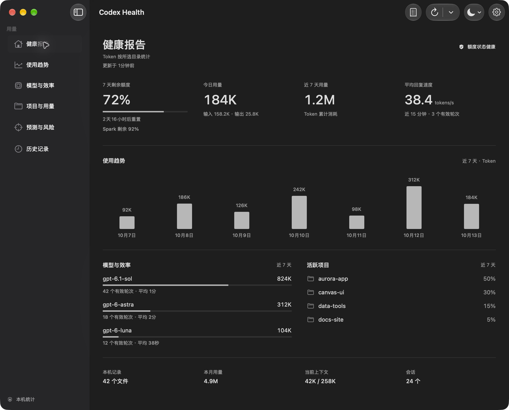

</details>

<details>
<summary>应用 Logo 切换</summary>

仅保留黑白扁平版与玻璃黑白版，默认使用黑白扁平版。

| 外观 | 黑白扁平版（默认） | 玻璃黑白版 |
| --- | --- | --- |
| 浅色 |  |  |
| 深色 |  |  |

</details>

## 菜单栏摘要

macOS 1.0.22（32）在手动刷新和定时刷新时直接查询当前账户额度，账户重置后无需等待新的本地会话记录。查询失败会保留上次采样并显示原因；旧会话记录不会覆盖更新的账户采样。只选择会话目录或未登录 ChatGPT 时不发起账户请求。

Mac 1.0.9 的手动刷新会明确显示新额度采样、暂无新采样、读取不完整或失败，并区分检查时间与额度采样时间。已配置更新器的 1.0.8（17）可在「偏好设置 → 关于 → 检查更新」升级；本次发布为开发签名、未公证的升级验证包。

菜单栏会显示当前 7 天额度剩余比例；点击后可快速查看额度、重置时间、平均回复速度、今日用量和权限提醒，并打开完整详情。

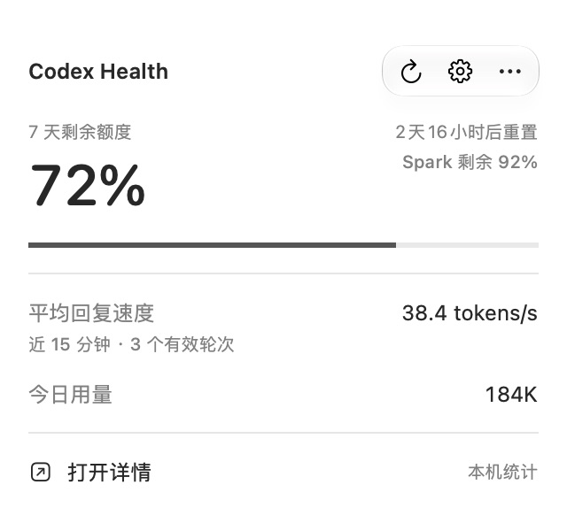

## 桌面小组件（WidgetKit）

在 macOS 桌面编辑模式中添加“Codex Health”小组件。小号展示额度概览，中号同时展示今天、近 7 天、本月用量、7 天额度与当前上下文。

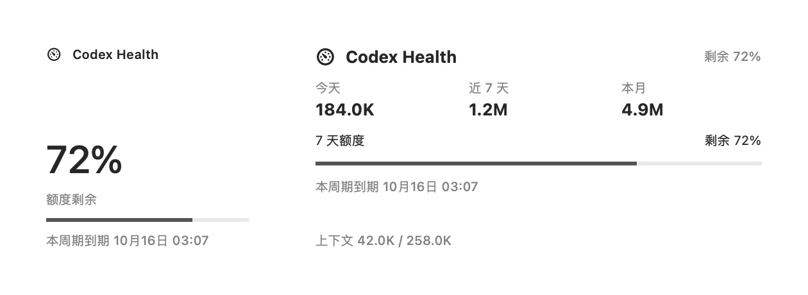

上图是当前 WidgetKit 内容视图的独立预览；桌面上的外框、背景材质和尺寸由 macOS 控制，会随系统版本与小组件样式变化。

如果之前安装过旧版临时签名包，请先退出并移除 `/Applications/Codex Health.app`，再安装最新版并启动一次，然后重新打开桌面小组件编辑器搜索“Codex Health”。

### 悬浮摘要组件预览

项目中的 `DesktopWidgetView` 是另一套 300 × 245 的悬浮摘要视图，目前未接入主应用入口。它展示三段用量、上下文及短周期额度；示例中的 16% 表示 5 小时额度已用比例。

| 浅色 | 深色 |
| --- | --- |
| 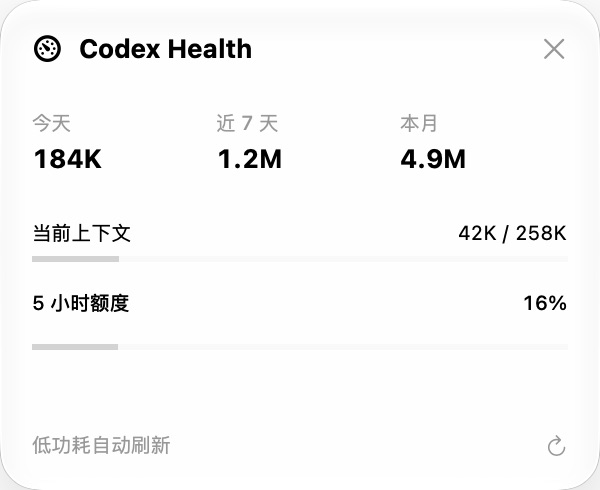 | 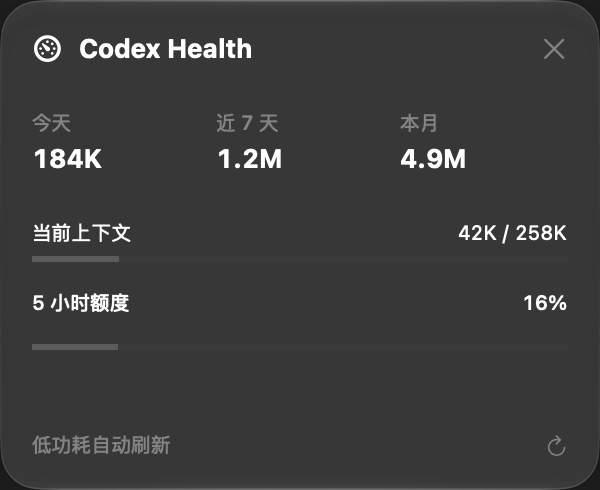 |

## 使用趋势

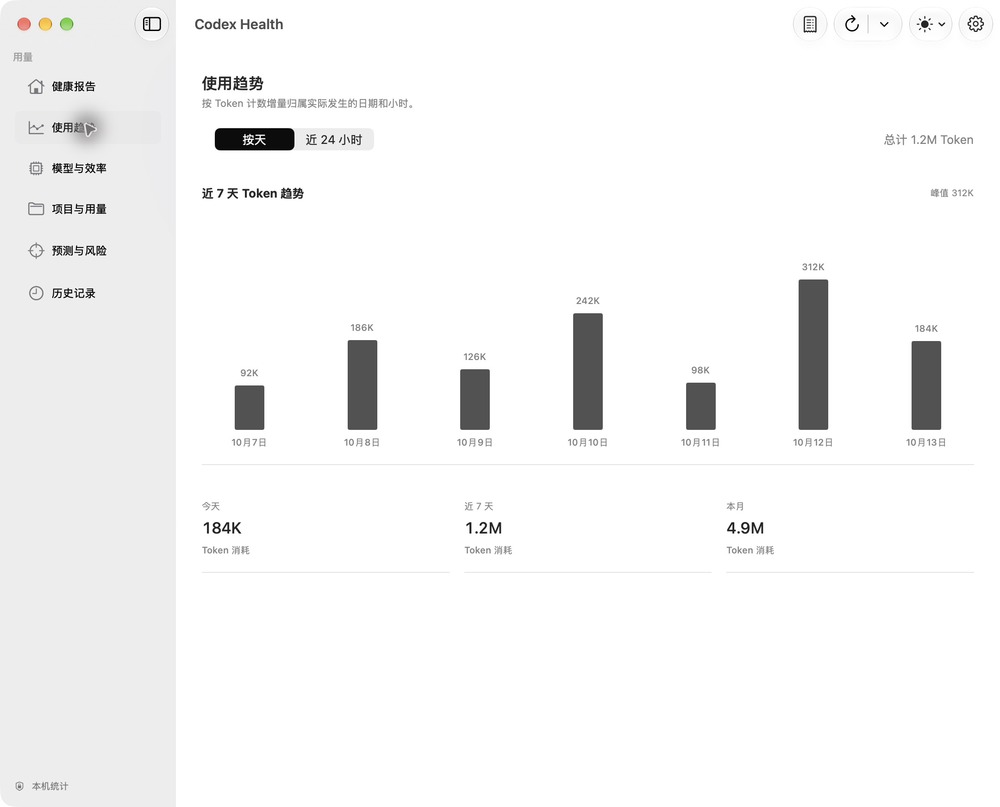

## 模型与效率

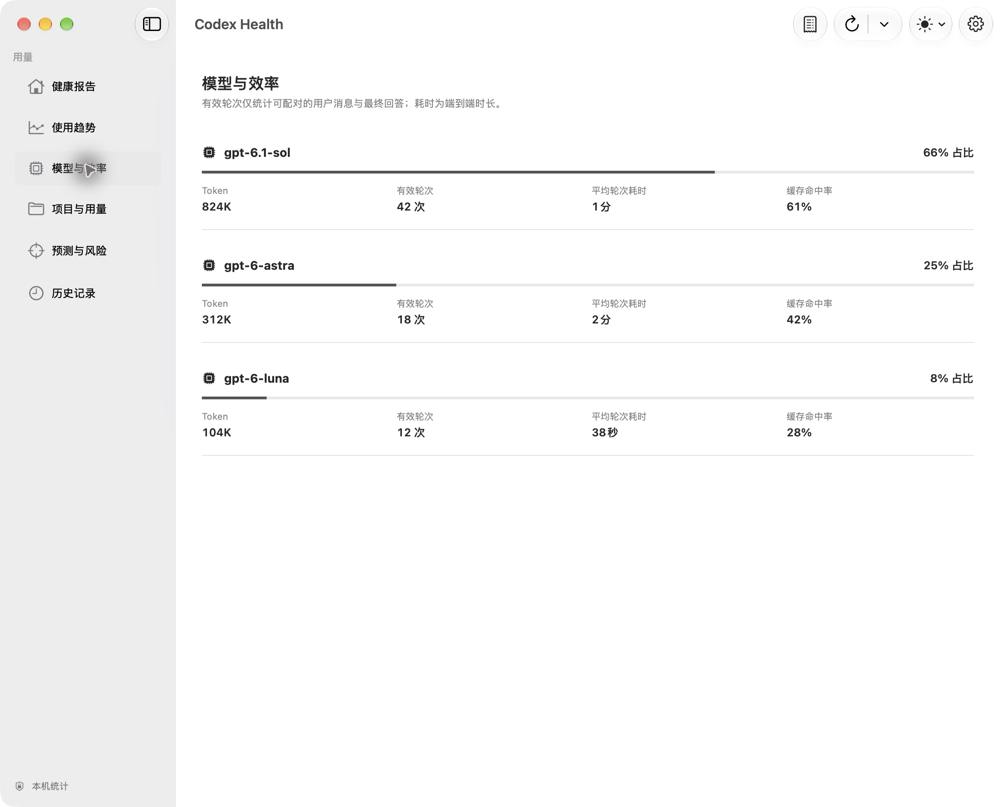

## 项目与用量

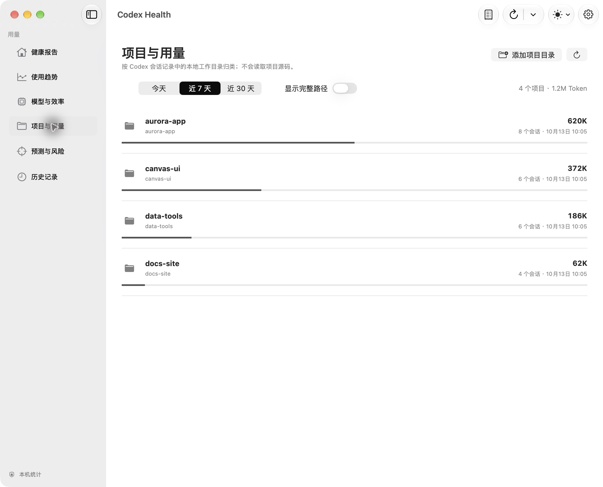

## 预测与风险

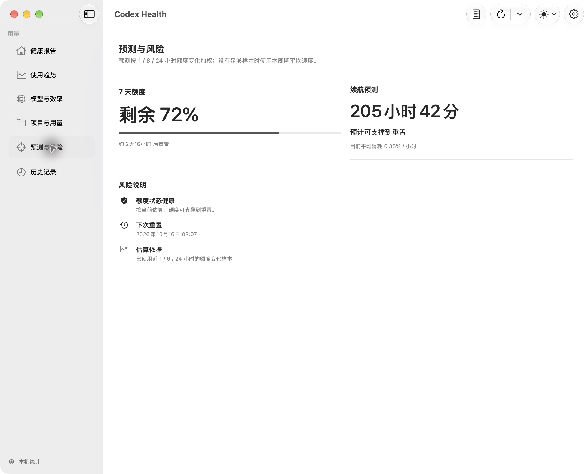

## 历史记录

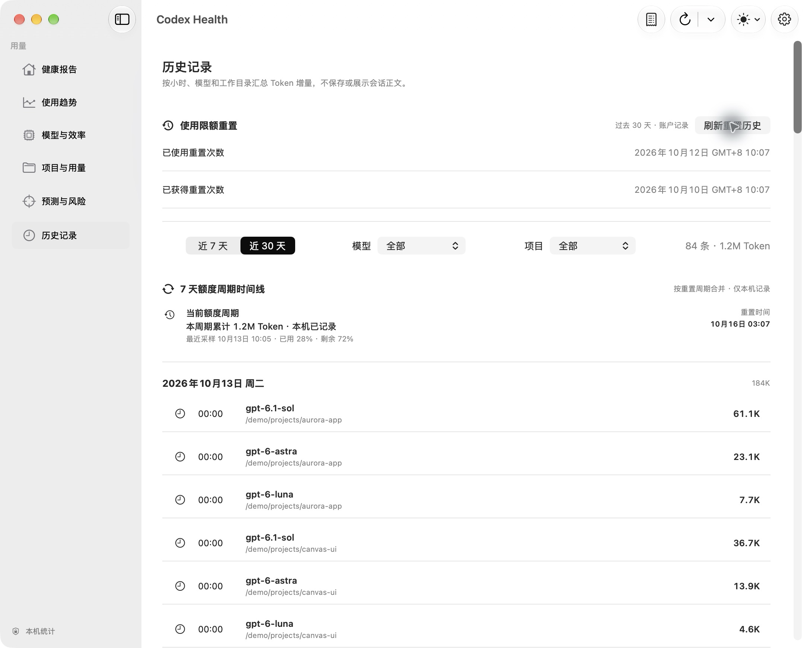

## Windows 界面与悬浮摘要

Windows 版沿用黑白灰 Dashboard，支持悬浮球和摘要卡片两种样式。当前源码版本为 0.1.2，下载区的已发布安装包仍为 0.1.1。

以下 Windows 截图来自前端界面与虚构演示数据，悬浮球截图为原尺寸；截图不代表 Windows 原生安装、置顶或 DPI 实测结果。

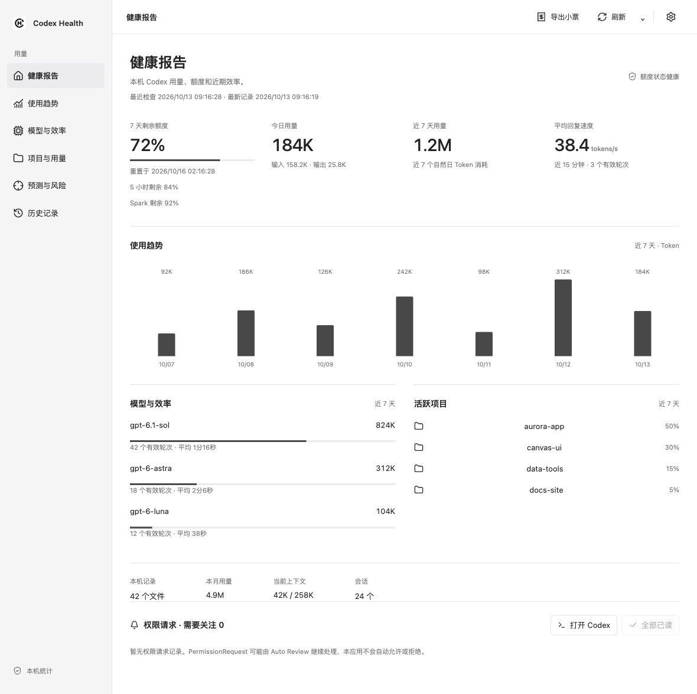

<details>
<summary>查看 Windows 深色模式</summary>

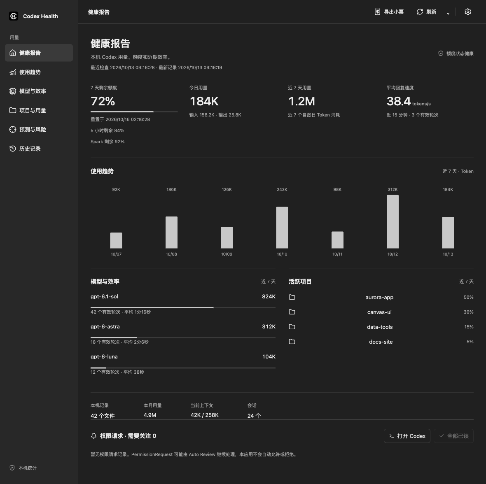

</details>

### 悬浮球

悬浮球显示七天剩余额度，可拖动并记住位置，双击打开 Dashboard；外观跟随主界面的浅色、深色或系统主题。没有有效额度或额度已到期时显示「—」。

| 浅色悬浮球 | 深色悬浮球 |
| --- | --- |
|  |  |

### 摘要卡片

在悬浮样式中选择摘要卡片，查看今日用量、近 7 天用量、上下文与短周期剩余额度；示例中的 84% 是 5 小时额度剩余比例。

| 浅色 | 深色 |
| --- | --- |
| 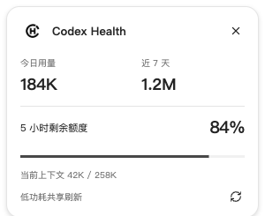 | 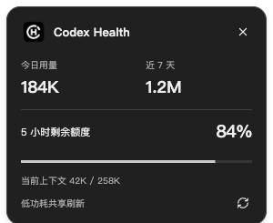 |

### 周用量小票

在 Dashboard 点击「导出小票」，预览后保存纯白背景 PNG，适合分享近七天的本机 Token 用量。

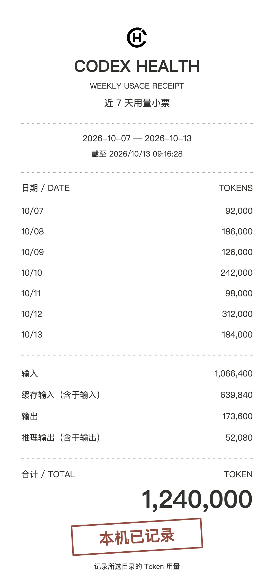

## 功能

- 菜单栏显示 7 天额度剩余百分比，图标和文字对比度由系统随外观自动调整
- 今日、近 7 天、本月 Token 用量，以及输入、输出、缓存和推理 Token 分类
- 当前会话上下文进度与 7 天额度重置倒计时
- 用量预测：按近 1 / 6 / 24 小时额度变化加权估算
- 项目排名支持今日、7 天、30 天切换
- 模型占比、有效轮次样本数与端到端平均轮次耗时
- 菜单栏摘要与健康报告显示近 15 分钟平均回复速度（tokens/s）和有效轮次数
- 按日 / 按小时趋势，可按模型或项目筛选
- 低额度、预计提前耗尽、即将重置提醒；阈值和同日去重均可配置
- Codex `PermissionRequest` 权限提醒：系统通知、提示音、菜单栏需要关注数量与最近请求列表
- WidgetKit 桌面小组件：小号展示额度概览，中号展示三段用量、额度与上下文

## 使用

1. 打开构建脚本输出目录中的 `Codex Health.app`；开发构建位于 `dist/debug.*`，发布构建位于 `dist/release.*`。
2. 第一次启动时，选择你的 Codex 数据目录（通常为 `~/.codex`）。
3. 点击菜单栏图标查看摘要；选择“打开详情”查看完整分析。
4. 在桌面编辑模式中添加“Codex Health”小组件。

### 权限提醒

1. 打开 Codex Health 设置中的“提醒”页，开启“Codex 权限提醒”。
2. 应用会把自己的 handler 增量合并到 `~/.codex/hooks.json`，并备份原文件；不会覆盖或删除已有 Hook。
3. 在 Codex 中运行 `/hooks`，检查并信任新安装的 `PermissionRequest` Hook。
4. 可在设置页发送测试提醒、重新检测或修复配置，也可以只卸载 Codex Health 自己的 Hook。

权限 Hook 只观察并上报事件，不会自动允许或拒绝请求。通知默认只显示项目名和工具类型；操作摘要需要手动开启，且会先过滤 token、密码、Authorization、Cookie 等敏感信息。由于 `PermissionRequest` 也可能由 Auto Review 继续处理，界面显示“最近权限请求 / 需要关注”，不把它描述为可靠的“当前待审批”。

应用会将所选目录保存为 macOS 书签。书签失效时提示重新选择，不会静默切回默认目录；选择新目录前先保存授权，保存失败则保留原目录。

## macOS 应用内更新

### OpenAI API 用量与费用

从 1.0.23 起，可在「设置 → API」输入 Admin API Key，或从只含一个密钥的 UTF-8 文本文件导入。点击保存或导入后，密钥保存在本机钥匙串，不写入偏好、会话统计缓存或安装包。

在详情侧栏选择「API 用量与费用」，查看密钥所属组织的本月消费、文本 API 输入/缓存输入/输出 Token、请求数，以及组织月度消费上限。费用与 Token 是组织数据，与本机 Codex 会话统计、ChatGPT 套餐额度分别展示；费用包含全部 API 消费，文本 Token 接口不涵盖所有音频、图像和存储用量。

费用与用量要求 `api.usage.read`，消费上限要求 `api.management.read`。只有上述三个官方 GET 接口会收到密钥，网络会话不使用磁盘缓存、Cookie 或跳转。进入页面时查询，5 分钟内复用内存结果，手动刷新立即查询；关闭页面后不安排后台轮询。月度统计按 UTC 日桶查询，包含当天已记录数据，并完整读取分页。

未配置组织消费上限时显示「未配置」；权限不足、网络失败及分页不完整单独提示，不显示为零消费。替换密钥会取消旧请求并清空旧组织数据。「预算剩余估算」仅为配置上限减去已记录费用，不能代表充值余额；准确余额请查看[官方账单](https://platform.openai.com/settings/organization/billing/overview)。

「设置 → 关于 → 检查更新…」使用 Sparkle 的标准更新窗口：检查版本、下载、签名验证，然后安装并重启应用，无需手动拖拽 DMG。关闭设置窗口不会中断已打开的更新窗口；下载可在 Sparkle 窗口取消，网络失败可重试。

仓库包含从已有 GitHub `SPARKLE_PRIVATE_KEY` 导出的公开配置，以及经过签名与篡改拒绝验证的 macOS 更新源；私钥保留在 GitHub Actions。Xcode 和构建脚本默认使用 `Resources/Updates.xcconfig`，可用 `UPDATE_XCCONFIG` 显式覆盖。更新源保留最近两个已签名版本；构建和发布验证与用户实际下载、安装、重启验收分别记录。首次从不含更新器的旧版升级仍需安装一次。发布前提与验证步骤见 [macOS 更新发布指南](docs/macos-updates.md)。

## 构建

环境要求：macOS 15+，构建需要带 macOS 26 SDK 的 Xcode 26 或更新版本（使用 Liquid Glass API）。发布脚本会自动使用本机 Apple Development 证书为应用和 WidgetKit 扩展签名；没有开发证书时才回退到临时签名（此模式下小组件可能不会出现在 macOS 选择器中）。

```bash
git clone https://github.com/niujt/CodexMeter.git
cd CodexMeter
./script/build_distribution.sh
```

如需强制使用临时签名进行本地测试，可执行 `SIGNING_MODE=adhoc ./script/build_distribution.sh`。

每次发布使用新的 `dist/release.*` 目录，保留应用、构建产物、DMG、`.sha256` 校验文件和 `release-info.txt`。可通过 `DIST_DIR` 与 `BUILD_DIR` 指定输出目录；如果已有同名应用或发布文件，脚本拒绝覆盖。打包后会验证主应用和 WidgetKit 扩展的版本、可执行文件、签名及 App Group，验证 DMG 完整性，并只读挂载确认包含 `Codex Health.app` 和指向 `/Applications` 的快捷方式。不安装应用，不启动真实会话读取，不自动清理产物。

从 1.0.20 起，小组件的 `CFBundleVersion` 与 `CFBundleShortVersionString` 一致，以匹配 macOS 扩展登记和 WidgetKit 视图校验；主应用仍使用独立递增的整数构建号供 Sparkle 比较更新。打包与 CI 会拒绝不兼容的版本组合。

已有发布包也可以独立复核：

```bash
./script/validate_distribution.sh --dmg /path/to/CodexMeter-1.0.8-macos.dmg
```

开发调试时可以执行：

```bash
./script/build_and_run.sh
```

开发构建同样使用独立的 `dist/debug.*` 目录；`--build-only` 只构建和验证，不启动应用。开发和发布构建将下载的依赖保留在 `output/macos/source-packages`（可用 `SOURCE_PACKAGES_DIR` 调整），并核对已嵌入的 Sparkle 框架、更新器与 XPC helper 签名。脚本保留临时签名和验证文件，删除旧安装或清理产物前应按 `AGENTS.md` 列出目标并获得确认。

### 回归与性能基准

```bash
./script/test_usage.sh
./script/test_usage.sh --benchmark
```

测试只使用生成的虚构会话、临时缓存和测试偏好域，不读取真实 Codex 数据或访问账户接口。默认保留测试产物，输出其目录；`TEST_WORK_DIR` 可指定工作目录。只有确认清理范围后，才设置 `CODEX_HEALTH_TEST_CLEANUP=1` 清理带清理处理的测试夹具及测试偏好域。

基准生成 2,001 个会话文件，其中一个含 20,000 条 Token 事件，分别测量首次加载、未变化刷新、追加刷新和强制全量解析的耗时与读取字节数；断言追加结果与完整解析一致，不以固定耗时作为通过标准。具体结果保存为虚构测试目录中的 `benchmark.json`，不能直接代表所有真实数据规模或机器的表现。

更新 README 截图时可以执行：

```bash
python3 script/preview_screenshots.py
```

脚本打开独立演示应用，使用真实页面组件和内存中的演示数据，不读取 Codex 会话、登录凭据或真实重置历史。通过侧栏切换页面，通过“演示预览”菜单切换明暗模式、菜单栏摘要、悬浮摘要组件和 WidgetKit 内容视图，再截取窗口。使用 `script/DocumentationSnapshotApp.swift` 提供演示入口与一致的用量数据。默认保留临时构建，可用 `--work-dir /path/to/fresh-directory` 指定新的目录；清理前按项目约定确认精确范围。

## 数据与限制

- 用量来自本机 `.codex/sessions` 和 `.codex/archived_sessions` 下的会话 JSONL 记录，不遍历插件缓存、技能目录或根目录的输入历史；也可直接选择会话目录。不同版本的 Codex 记录格式变化可能影响统计。
- 目录选择由菜单、详情、权限 Hook 和重置历史共用：已选目录优先，否则依次采用应用的 `CodexHome`、`CODEX_HOME`、`HOME/.codex`。选择 `sessions`、`archived_sessions` 或普通会话目录时只统计本地 Token，不推断上级主目录、不读取上级登录凭据，也不安装 Hook。
- Token、模型与项目统计属于所选目录，不能按账户分摊。额度缓存、预测采样和通知去重按目录及登录身份隔离；只在内存中使用请求凭据，偏好中保存身份与文件版本的摘要，不保存访问令牌、原始账户 ID 或登录文件。无法识别 ChatGPT 登录、退出登录或使用 API Key 时，额度与预测暂停，本地 Token 统计继续。
- 首次识别登录以 `auth.json` 修改时间为额度采样边界；运行中发现账户变化后只接受变化之后的新额度事件，并立即清空旧显示、预测和小组件摘要。令牌刷新且身份保持一致时不重置采样；没有可识别用户信息的非 JWT 凭据采用保守的令牌摘要分区。重启或重新选回目录时，若登录文件在未监测期间变化，则重新收紧采样边界，避免重放期间其他账户的额度。旧版无来源信息的全局额度缓存与预测历史不会迁移。
- 会话额度记录缺少可靠的账户标签，上述边界过滤不能证明每条记录的账户归属；同一目录同时运行不同账户的 Codex 实例时，请为每个账户使用独立 `CODEX_HOME`。账号变化后可能需要完成一次新的含额度采样的会话。
- 切换目录会取消旧读取并清空旧结果，过期的进度与请求结果不会覆盖新目录；新目录读取失败只保留该目录已有的结果。登录变化通过所选主目录和 `auth.json` 的文件事件检查，不轮询或扫描其他 Codex 目录。
- 权限 Hook 写入所选主目录的 `hooks.json`，提醒队列与历史按目录分别保存在 `~/.codex-monitor/sources/<目录摘要>/`。切换后仅监测新目录；旧目录的 Hook 和历史保留，切回可继续读取。提醒是目录内的本地会话事件，不代表账户历史。安装和修复只合并应用拥有的 Hook，保留其他 Hook。
- 重置历史按账户和目录保存在本地应用数据目录，重启后先显示已保存记录。首次同步分页读取可用历史；后续利用已保存的事件 ID 和时间边界补取新记录，连续两页均已保存且时间顺序正常时停止，保留重叠页并去重；发现已返回页无序时继续完整分页。接口只使用已知的游标参数，不虚构日期查询参数。进入历史页时，距上次成功同步未满 5 分钟则直接复用本地记录，手动刷新立即补取；超时或连接中断重试一次，同步失败保留已有历史。切换目录、账户或退出登录立即清空当前显示，切回账户时只加载该账户与目录自己的历史；过期请求不会回写。不使用默认目录回退。此接口不是公开稳定 API，认证或接口变化可能导致查询不可用。
- 今日、近 7 天、本月及趋势按累计 Token 计数的增量和发生时间归属；计数下降时作为新计数段处理。历史列表按小时、模型和工作目录汇总。
- 菜单栏、详情窗口和设置共享同一份用量数据。打开详情会优先显示已有结果，仅在数据达到刷新间隔时检查更新；手动刷新立即检查变化文件。
- 首次读取流式解析文件；正常追加时从最后一个完整换行处继续，保留未完成轮次状态，不重复统计末尾记录。追加前检查文件身份、创建时间、大小、修改时间以及旧内容开头和末尾各最多 4 KiB 的摘要；截断、文件替换或检查不通过时完整重读。抽样检查无法识别保持同一文件身份、避开抽样区域的中间内容改写；这种异常需要强制重建。未变化文件复用统计摘要，时间窗口过期仍重新筛选。
- 摘要按会话分别保存在本机缓存目录，单个会话变化只写其摘要；索引仅在文件集合改变时更新。缓存不包含对话正文或末行原文，只保存统计、解析状态和校验摘要。重启后按文件身份、修改时间和大小校验复用；旧版、损坏或日历/时区不匹配的缓存自动重建。被移除的会话从索引排除，旧摘要由系统缓存清理回收。
- 目录条目按目录修改时间与身份复用，避免每次重新列出全部目录。刷新仍检查已知会话文件元数据以发现追加和替换，排序时不重复读取文件属性；文件集合和元数据未变化、没有跨越汇总时间或额度重置边界时复用汇总结果。强制重建会重新列目录并完整读取文件。缓存被系统清理后，下次启动重新读取。
- 若怀疑统计异常，可在详情工具栏的刷新菜单或菜单栏摘要的“更多”菜单选择“重新读取全部记录”；普通刷新继续使用追加和摘要缓存。
- 进度中的“检查文件”包含复用缓存的文件，“实际读取”仅统计本轮尝试解析的文件，两者分别显示。
- 前台自动刷新遵循设置的间隔；后台使用 macOS 系统调度，基准间隔不低于 15 分钟，允许系统合并或调整执行时机。低电量模式的基准间隔不低于 30 分钟，热压力严重时不低于 60 分钟；休眠时暂停调度。后台额度提醒也会随自动刷新降频，打开摘要及手动刷新可按需立即检查。
- 权限提醒仅在有事件需要过期或清理时安排一次处理；空历史不维持轮询计时器，内容不变不写文件。关闭菜单弹窗后停止速度重绘，显示时仅安排样本过期更新并按分钟合并；菜单栏文字和额度缓存未变化时也不重复绘制或写入。
- “平均耗时”只使用可配对的用户消息与明确的最终回答或任务完成事件；缺少完成标记的记录不计入有效轮次，不是服务端 API 延迟。
- “近 15 分钟平均回复速度”按窗口内完成的有效轮次计算：输出 Token 总数 ÷ 对应轮次耗时总和。优先使用任务开始事件，否则使用用户消息作为起点；终点为最终回答或任务完成事件。耗时包含思考、工具执行与等待，轮次之间的空闲时间不计入，因此这是端到端平均回复速度。输入 Token 不计入，推理 Token 不重复叠加到输出计数；未完成、已中止、缺少可靠输出增量或耗时异常的轮次不计入。无有效样本时显示“暂无样本”；样本按实际完成时间滚动过期，未变化文件的缓存也会重新筛选。
- 小组件显示最近成功读取的摘要；超过 30 分钟未更新会提示数据可能过期，额度达到重置时间后等待新周期采样。
- 额度预测仅使用当前目录、登录边界及同一重置周期的真实额度采样时间；重复刷新与缓存复用不会制造采样，样本较少时会回退到当前周期平均速度，不再用跨账户的目录 Token 总量推算剩余轮数。
- 这是一个非官方的本地辅助工具，与 OpenAI/Codex 没有隶属关系。

## 隐私

Codex Health 不会上传 `.codex` 目录、会话内容或统计数据。小组件通过 App Group 读取应用写入的本地摘要缓存。
进入历史页自动查询或手动刷新重置历史时，当前登录的访问令牌及账户 ID 只发送到固定 `chatgpt.com` 接口；请求不接受重定向，不保存 Cookie，不刷新或改写登录文件。已同步的重置历史保存在本地应用数据目录的 `CodexMeter/reset-history` 下，只包含事件 ID、类型、时间、同步时间及账户/目录分区摘要，不保存令牌、原始账户 ID、目录路径或会话正文；历史不会上传到其他服务。
